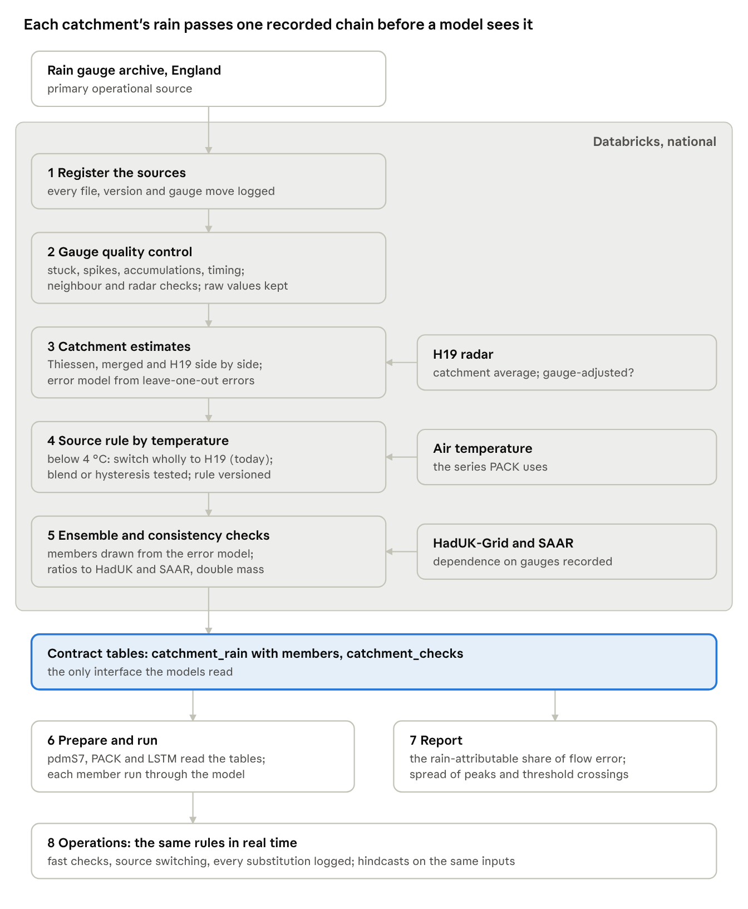
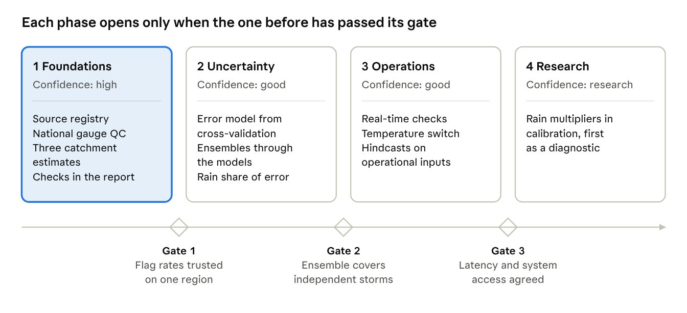

# Rainfall inputs and uncertainty: an end-to-end plan

Nov 14, 2026 · @Jonathan Payne

## Summary

We can build one recorded chain from raw rain gauge data to model forcing with its uncertainty attached, and most of it rests on proven methods. The new work is in joining the stages and recording every decision.

- **Gauge quality control runs in Databricks**, nationally, beside the gauge archive. Neighbour checks need the whole network, and every catchment then inherits the same rules.
- **A separate inputs product** holds quality control, catchment averaging and the rainfall error model. pdmS7 and the other models read its tables; they do not own it.
- **Rain gauges stay the primary operational source.** H19 catchment averages take over entirely below 4 °C, where gauges under-catch snow or freeze. Today's operational setup is the baseline every change is tested against.
- **Uncertainty travels as an ensemble** of catchment-rain series, built from cross-validated gauge errors, and is run through the models to show how much flow error the rain alone explains.

Phases 1 to 3 are achievable with known methods. Calibrating parameters under rainfall uncertainty is research, and should start as a diagnostic.

## The baseline today

Operational catchment rain today is Thiessen-weighted gauges, with H19 included at a weight of 0.01 so the series continues if every gauge fails; it passes through PACK, and below 4 °C the input switches wholly to H19.

Every change in this plan is measured against that baseline, on the same events and the same models. Six things about it need testing:

- **Partial gauge failure.** Today the remaining weights are scaled up, so a failed gauge's area is shared among all the others in proportion to their own areas, including gauges far from it. Redrawing the polygons over the gauges still reporting gives that area to its nearest neighbours instead. The weight sets for every combination of failed gauges can be computed in advance, so the redraw costs nothing at run time. `reweight_missing()` tests both on past records: drop each gauge in turn, rebuild the catchment rain both ways, and compare each with the full-network value.
- **The fallback.** When every gauge fails, the catchment gets H19 alone, uncorrected, so H19's bias against the gauges decides that step's volume. The 0.01 share is negligible otherwise, but hindcasts must reproduce it.
- **The step at 4 °C.** If H19 and the gauges differ in bias, catchment rain jumps when the temperature crosses 4 °C, and can switch back and forth on days that hover near it. A switch with hysteresis, or a short blend band, may behave better.
- **H19's own errors in snow.** Bright band, beam overshoot of shallow snowfall at range, and the conversion of snow reflectivity to rain rate. The switch trades gauge under-catch for radar error; the temperature-band analysis says which is smaller, region by region.
- **Which temperature.** The series, its location and its step decide when the switch fires: catchment mean, a station, or PACK's own input. It should be one recorded choice.
- **Calibration matches operations.** Models are calibrated and hindcast with the same weighting, fallback and switch that forecasters' inputs use.

## Challenger methods

The calibration of record uses the operational scheme exactly: fixed Thiessen weights scaled up when gauges fail, H19 at 0.01, the 4 °C switch. Other methods run beside it as challengers, so any gain is measured and can make the case for changing operations.

| Method | Fits today's system? | What it tests |
| --- | --- | --- |
| Operational baseline | Yes: it is today's system | The reference every other method is scored against |
| SAAR-scaled Thiessen weights | Yes: only the weight values change | Whether correcting each gauge's share for its rainfall climate improves the water balance |
| Cross-validated static weights | Yes: only the weight values change | Weights chosen to minimise leave-one-gauge-out error, still fixed and still scaled up on failure |
| A different switch temperature, or hysteresis | To confirm: depends on what the system lets us set | Whether the temperature-band analysis finds a better rule |
| Polygons redrawn when gauges fail | No: needs a system change | How much scaling up costs, catchment by catchment |
| Gauge-radar merging | No: needs a system change | The gain from using H19's pattern in every step, not only as a fallback |
| Rain ensemble | No: research | How much of the flow error the rain explains |

**How they are compared.** Each method gets its own calibration, with the same structure, bounds, budget and seeds, because parameters adapt to their inputs. All are scored on the same validation years and events, with gauge outages replayed as they happened, and in hindcast mode as forecasters would have run them. Results are reported in two groups: gains we could take now by changing weight values, and gains that need the operational system changed.

## Where it lives

The inputs chain belongs in its own product beside the data, with the models reading a fixed set of tables.

| Reason | What follows |
| --- | --- |
| More than the PDM needs it | The LSTM team, PACK and future models read the same cleaned rain and the same uncertainty, without depending on a rainfall-runoff package |
| It works at national scale | Quality control and grid averaging run in Databricks, in Python or Spark, over every gauge at once |
| It changes at a different pace | A quality-control rule may change weekly; model numerics change rarely and under golden tests |

pdmS7 keeps what it already has for one catchment at a time: `merge_rainfall()` and its cross-validation, `check_inputs()`, `water_balance()`, `gauge_response()` and `screen_events()`. It gains only the model side: running an input ensemble and reporting its effect on the flow.

## Local R tools

A modeller working on one catchment needs the same checks and gauge weighting in R, without waiting for the national product, and they must give the same answers as Databricks.

**One rule book, two implementations.** Each check is defined once (its code, its test and its threshold) in a versioned rule file, with golden test cases, as the C core has now. The R tools and the Databricks jobs both pass those cases, so a flag raised locally means what it means nationally.

| Tool | What it does | Status |
| --- | --- | --- |
| `gauge_checks()` | Single-gauge checks on the catchment's gauges: stuck tippers, spikes, accumulated totals, long zero runs, timing offsets | New |
| `neighbour_checks()` | Each gauge against the others in and around the catchment: dry while wet, daily ratios, double-mass breaks | New |
| `source_checks()` | Catchment rain against H19, HadUK-Grid and SAAR: monthly ratios against their own usual value | New |
| `gauge_weights()` | Thiessen, inverse-distance or SAAR-scaled weights, reported and mapped | New |
| `reweight_missing()` | Weights recomputed step by step when gauges drop out, each change recorded | New |
| `compare_weightings()` | Each scheme's cross-validated error, its effect on the water balance and the flow score after a model run | New |
| `merge_rainfall()`, `rainfall_cross_validation()` | Thiessen, multiquadric and conditional merging with radar; leave-one-gauge-out errors | In pdmS7 |
| `check_inputs()`, `water_balance()`, `gauge_response()`, `screen_events()` | Input checks, annual balance and Budyko limits, each gauge's response, flagged events left out | In pdmS7 |

The checks live in `reach.validate` and the weighting and comparison tools in `reach.forcing`, both separate from pdmS7. Neither fetches anything itself: every download goes through `reach.io`. The local tools read either raw files or the national tables, so they work now and carry on working once Databricks supplies the data.

## The chain

Eight stages take raw records to model results, five of them in Databricks, and the models read only the contract tables at the centre.

The stages in brief:

1. **Register the sources.** Gauge records with quality codes, type, heating and moves; H19 at 15 minutes; HadUK-Grid daily and monthly; SAAR. Every file and version is logged.
2. **Gauge quality control.** Single-gauge checks first (stuck tippers, spikes, accumulated totals after outages, timing and summer-time shifts), then neighbour and radar checks and double mass. Flags plus a corrected series; the raw value is never overwritten.
3. **Catchment estimates.** Thiessen, merged and H19 averages side by side. Leave-one-gauge-out errors give an error model by intensity, gauge density, season and storm type.
4. **Source rule by temperature.** Below the threshold, unheated gauges under-catch snow or freeze, so the catchment rain switches wholly to H19, as operations do now. Whether a blend, a step with hysteresis or a gauge catch correction does better is tested, not assumed. The rule feeds PACK's input and is versioned.
5. **Ensemble and consistency checks.** Members drawn from the error model; ratios to HadUK and SAAR by month and year, and double mass against flow.
6. **Prepare and run.** Gaps filled by recorded methods, units and steps aligned, flags attached so `screen_events()` leaves flagged events out of calibration. Each model runs the best estimate and the members.
7. **Report.** How much of the flow error the rain alone explains, event by event, and the spread it gives peaks and threshold crossings. This separates a wrong model from wrong rain.
8. **Operations.** The same rules in real time, in a lighter form, with every substitution logged; hindcasts use inputs prepared the same way, so verification matches what forecasters had.

## Recommended processes

Eight processes run the chain; each has a trigger, an owner and a record, so any value a model uses can be traced to the decision that made it.

| Process | Trigger | Owner | Leaves on record |
| --- | --- | --- | --- |
| 1 Onboard a source | A new dataset or feed | Steward | Register entry, licence, independence note, validation |
| 2 National QC cycle | Each new batch of gauge data | Custodian | Flags, corrected series, rule versions |
| 3 Change a rule | A missed fault or a false alarm | Steward | Rule version, golden cases, back-test, approval |
| 4 Prepare a catchment | A calibration or recalibration | Modeller | Local checks, weighting choice, sign-off in the calibration log |
| 5 Assess input uncertainty | A candidate model ready for acceptance | Modeller | Ensemble run, rain share of flow error, decision |
| 6 Operate in real time | Every forecast cycle | Forecasting duty officer | Flags, substitutions, source switches |
| 7 Review an event | A flood or a forecast miss | Steward with the modeller | Event review, flags confirmed or cleared, field requests |
| 8 Validate and release | Each quarter, and before any rule release | Owner | Validation report, release notes |

Full steps, decision points, criteria and roles for each process: [Processes in detail](02-processes.md)

### 1 Onboard a source

1. Register the dataset: provider, resolution, period, version, licence and who may use it.
2. Write its independence note: which gauges, if any, it is built from or adjusted to.
3. Run it through the consistency checks on a test set of catchments, against the sources already trusted.
4. The Steward approves it, and only then does it enter `catchment_rain` as a source.

### 2 National QC cycle

1. Ingest the new data and record the file versions.
2. Run the single-gauge checks, then the neighbour and radar checks, under the current rule versions.
3. Write flags and the corrected series; keep the raw values.
4. Send flags above a severity threshold to a review queue rather than correcting them automatically.
5. Raise persistent faults with the hydrometry field team, gauge by gauge.

### 3 Change a rule

1. Propose the change with the events that prompted it.
2. Add golden cases that show the fault caught and a sound record left alone.
3. Back-test on the whole archive: flag rates before and after, by region and season.
4. Change Databricks and the R package together; both must pass the golden cases.
5. The Steward approves; the rule's version rises and the release notes say why.

### 4 Prepare a catchment

1. Pull the national tables for the catchment, or run the local R checks on raw files where the tables do not exist yet.
2. Review flags on the catchment's gauges, and any period where the sources disagree.
3. Compare weighting schemes with `compare_weightings()` and choose one, with the reason.
4. Run `water_balance()` and the event checks; flagged events leave the calibration.
5. Record the input versions, the weighting and the decisions in the calibration log.

### 5 Assess input uncertainty

1. Run the calibrated model on every ensemble member.
2. Report the spread of peaks and threshold crossings, and the share of flow error the rain explains, event by event.
3. Where the rain explains a miss, record it as an input problem, not a model one.
4. Accept, or send the catchment back to process 4 or to structure selection, and record which.

### 6 Operate in real time

1. Run the fast checks on each cycle's data, within the latency the cycle allows.
2. Substitute for failed gauges by the recorded weighting, and switch sources by the temperature rule.
3. Tell the duty officer when a substitution or switch affects a forecast catchment.
4. Log every substitution and switch, for process 7.

### 7 Review an event

1. Compare the gauges, H19 and the flow for the event, with the real-time decisions taken.
2. Confirm or clear each flag; feed what was learned into process 3.
3. Record whether the forecast error came from the rain, the model or the flow record.

### 8 Validate and release

1. Report flag rates by gauge and region, cross-validation errors, and the ensemble's coverage of independent storms.
2. Check that no restricted data has entered a published output.
3. The Owner signs the release; the models record which release they used.

## Data sources and licences

The chain runs on open data by default, adds the licensed H19 and FEH SAAR grids we hold, and tags every row with its licence so restricted data never reaches a published output. Licences below are from memory; confirm each before use.

| Purpose | Source | Licence | Independent of gauges? |
| --- | --- | --- | --- |
| Gauge rain | EA Hydrology Data Explorer and rainfall API | Open | (is the gauges) |
| Radar rain | H19 | Held under licence | To confirm: may be gauge-adjusted |
| Annual average rain | FEH SAAR grids | Held under licence | No; 1961 to 1990 gauges |
| Gridded rain | HadUK-Grid, CEH-GEAR | Open | No |
| Independent rain | ERA5 and ERA5-Land, GPM IMERG | Open with attribution | Largely; coarse |
| Temperature and wind | MIDAS Open, ERA5 | Open | Yes |
| Evaporation | CHESS-PE, ERA5 | Open | Yes |
| Snow | MIDAS Open snow depth, MODIS snow cover | Open | Yes |
| Soil moisture | COSMOS-UK, ESA CCI | Open | Yes |
| Groundwater | EA borehole levels, BGS hydrogeology maps | Open | Yes |
| Flow and catchments | NRFA, CAMELS-GB | Open | Yes |
| QC method | GSDR quality-control code | Open code; restricted data | n/a |

The numerical comparisons between gauges, SAAR, HadUK-Grid and H19: [Source comparisons](03-source-comparisons.md)

The step-by-step plan for what to extract, download and generate in Databricks: [Data build](04-data-build.md)

- **FEH SAAR against the HadUK long-term mean.** SAAR is the 1961 to 1990 reference; HadUK covers recent decades. Their ratio shows how far each catchment's climate has moved, which separates a real change from a gauge fault.
- **Open core.** The rule book, golden cases, package examples, CI and published method notes use open or synthetic data only.
- **Restricted tags.** Any row built on H19 or FEH SAAR carries a restricted tag, and outputs inherit it. The export step refuses restricted rows without an explicit, recorded override.
- **Open question:** whether the FEH terms cover the whole organisation or named users, since the national jobs run under service accounts.

## The data contract

Four tables pass between Databricks and the models; everything upstream may change freely provided these stay stable.

| Table | One row per | Key columns |
| --- | --- | --- |
| `gauge_register` | gauge and period of record | gauge id, location (BNG), height, type, heated or not, moves and their dates, source system |
| `gauge_series_qc` | gauge and time step | time (UTC), step, raw mm, corrected mm, flag codes, rule version |
| `catchment_rain` | catchment, source, member and time step | catchment, source (`thiessen`, `merged`, `h19`, `haduk_daily`, `haduk_monthly`), member (0 = best estimate), time, step, rain mm, quality share, flags |
| `catchment_checks` | catchment, check and period | check (ratio to HadUK, ratio to SAAR, double mass, cross-validation error), value, threshold, flag |

The `catchment_rain` layout extends the one in `future-directions.md` with a member column and a flag column, so a best estimate and its ensemble share one table. Temperature for the source rule comes from the same place as PACK's input, recorded with each switch.

## Roadmap

Four phases, each opened by a gate: the first three use known methods, the fourth is research.

Phase 1 is mostly engineering and pays off on its own: cleaner rain and a consistency report in every calibration. No dates are set yet; they depend on the open decisions below.

## Limits and risks

Every uncertainty estimate here is conditional on an error model, because no source is the truth.

- **The sources are not independent.** HadUK-Grid is interpolated from gauges, and H19 may be adjusted to gauges. Agreement between them and the gauges is then weaker evidence than it looks. Each source's dependence on the gauge network needs documenting before it is used as a check.
- **Snow under-catch is itself uncertain.** Wind-dependent catch corrections carry errors of tens of per cent, so the cold-weather rule needs its own validation against spring flows.
- **The error model must be validated, not assumed.** Cross-validation errors at gauges understate errors between gauges in sparse areas; the ensemble needs checking against independent storms.
- **Flow is uncertain too.** Ratings, especially above the highest gauging, belong in the same framework eventually. The extrapolation checks in pdmS7 are a start.
- **Rain multipliers in calibration over-fit easily.** Fitted storm by storm, they can absorb model error and hide a wrong structure.

## Governance

The inputs chain is a shared data product, governed as one, like the hydrological terrain model in `future-directions.md`.

- **An Owner and a Steward** for the product as a whole, with Custodians for each source feed.
- **Versioned rules.** Every quality-control rule, source-selection threshold and error model carries a version, and every output row records the versions that made it.
- **A record of every change.** A corrected value keeps the raw value, the rule that changed it and the reason; nothing is overwritten.
- **Validation reports** for each release: flag rates by gauge and region, cross-validation errors, and the ensemble's coverage of independent storms.
- **Model runs cite their inputs.** The pdmS7 calibration log and run log record the `catchment_rain` version and members used, so a result can be traced back to the gauges.

## Open decisions and next steps

Decided: gauge quality control runs in Databricks, nationally. The checks go in `reach.validate` (the rule book, its golden cases, `gauge_checks()`, `neighbour_checks()`), as `reach.io` already plans. Everything downstream goes in `reach.forcing`: weighting, catchment rain, source comparisons, event uncertainty, ensembles and exports. Both fetch through `reach.io`. pdmS7 suggests `reach.forcing`, and its rainfall tools move there once it is stable, with aliases kept. Each package has its own repository, CI and versions; `reach.forcing`'s first release rebuilds the operational catchment rain, with `gauge_weights()` and the long-term statistics.

Still open:

- [ ] Whether H19 is adjusted to gauges, and against which gauges, which decides whether it can serve as an independent check
- [ ] Which gauges are heated, and whether that record exists for the whole network
- [ ] The temperature source for the cold-weather rule, and whether the 4 °C threshold is the right one for every region
- [ ] Who owns the product, and where it sits among the Flode modules
- [ ] The latency of gauge and H19 data in operations, which bounds what real-time quality control can do

First steps:

1. Agree the four tables in the data contract with the Databricks side.
2. Build the single-gauge checks (stuck, spikes, accumulations, timing) on one region's gauges, and measure their flag rates.
3. Add the neighbour and radar checks once the single-gauge checks are trusted.
4. Produce `catchment_rain` and `catchment_checks` for the critical catchments, and show them in the pdmS7 calibration report.
