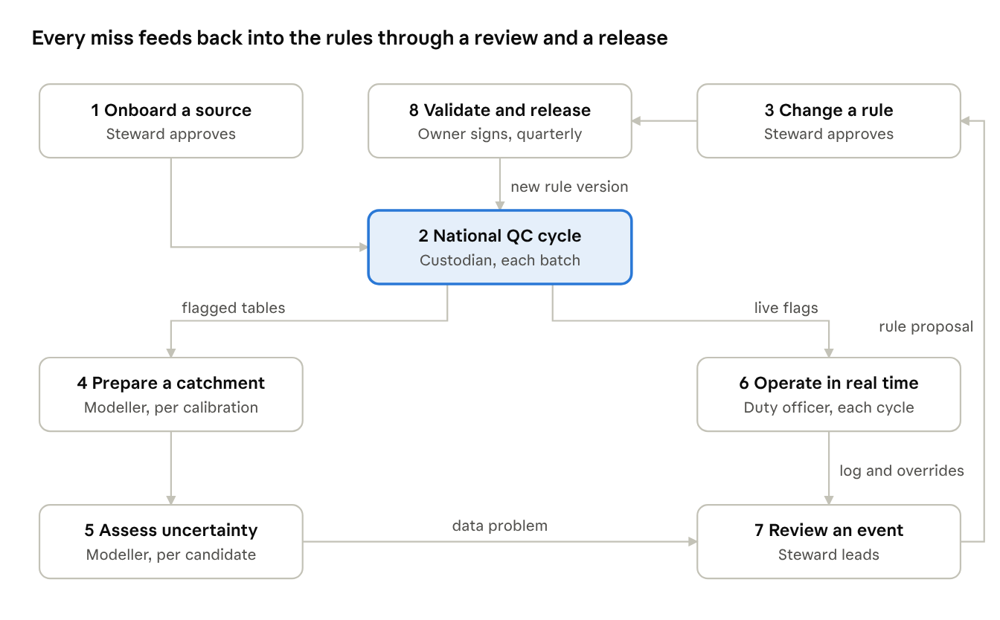

# Processes in detail

Each process below sets out its inputs, its steps with their decision points, what counts as done, and who acts. The summary table is on the main tab.

## How the processes connect

The national QC cycle sits at the centre; every miss found downstream comes back to it as a rule change, validated and released before it takes effect.

## 1 Onboard a source

No dataset reaches a model until it is registered, its licence and independence are written down, and it has passed the consistency checks on a test set of catchments.

|  |  |
| --- | --- |
| Inputs | The dataset or feed, its documentation, its licence terms |
| Outputs | A `source_register` entry; a validation note; the source enabled in `catchment_rain` |
| Done when | The Steward has approved the validation note |
| Tools | Databricks ingest job; `source_checks()` for the test catchments |
| Roles | Custodian prepares; Steward approves; modellers and forecasters informed |

1. **Register.** Record the provider, product name and version, spatial and time resolution, period, update frequency, units, time zone and time convention (step start or end), and the licence: who may use it, and whether outputs may be published.
2. **Write the independence note.** Which gauges, if any, the product is built from or adjusted to, and over what period. If unknown, say so; the source is then treated as dependent.
3. **Choose the test catchments.** At least one each of upland, lowland, chalk, urban and snow-prone, with good flow records, so a fault in one setting is not hidden by the others.
4. **Run the consistency checks.** Monthly and annual ratios to trusted sources, double mass, timing against flow, and, for rain, event totals against gauges.
   - Ratios drift over time → find the change point and record it before going on.
   - Timing offset of one step or more → fix the time convention, then rerun.
5. **Write the validation note.** What was checked, what was found, the known weaknesses, and where the source should and should not be used.
6. **Approve and enable.** The Steward approves; the source is switched on in `catchment_rain` with its licence tag, and the release notes record it.

A source that fails stays registered but disabled, with the reason, so the same work is not repeated.

## 2 National QC cycle

Every new batch of gauge data passes the same ordered checks, each value leaves with a flag, and only low-severity faults are corrected without a person looking.

|  |  |
| --- | --- |
| Inputs | New gauge data; the gauge register; H19 for the same period; the current rule book |
| Outputs | `gauge_series_qc` rows (raw, corrected, flags, rule versions); the review queue; field requests |
| Done when | Every value in the batch has a flag; the review queue is cleared within its target time |
| Tools | Databricks QC jobs, scheduled daily for the archive and with each feed for operations |
| Roles | Custodian runs and clears the queue; Steward decides contested cases; hydrometry field team acts on requests |

1. **Ingest.** Record the file, its version and the time received. Convert to UTC and the step-start convention.
2. **Single-gauge checks**, in this order, so a later check does not fire on an earlier fault:
   - impossible values (negative, above the physical limit for the step);
   - stuck tipper or flat line during rain elsewhere;
   - accumulated totals after an outage, spread or flagged;
   - spikes against the gauge's own climatology for the season;
   - long zero runs while neighbours and radar are wet;
   - timing offsets, from lagged correlation with neighbours and radar.
3. **Network checks.** Daily ratios to neighbours and to H19; double mass against the neighbour mean, with a change-point test on the ratio.
4. **Grade each flag.**
   - *Low:* known fault, safe fix (for example, a recorded timing offset). Corrected automatically.
   - *Medium:* likely fault, fix uncertain. Value kept, flagged, used with lower weight.
   - *High:* value not usable. Excluded from catchment averages; sent to the review queue.
5. **Review the queue.** Custodian confirms or clears each high flag; the Steward decides disputes. Every decision is recorded with its reason.
6. **Raise field requests.** A gauge flagged repeatedly, or with a step change, goes to the field team with the evidence. Its fix date is recorded, so the series can be split there.

Starting severity thresholds come from the GSDR rules and are tuned through process 3, never by hand in the job.

## 3 Change a rule

A rule changes only with evidence, new golden cases, a back-test on the whole archive, and the same change in Databricks and R, approved by the Steward.

|  |  |
| --- | --- |
| Inputs | The events that prompted the change (from process 2 or 7); the current rule book |
| Outputs | A new rule version; golden cases; a back-test report; release notes |
| Done when | Both implementations pass every golden case and the Steward has approved |
| Tools | Rule file under version control; golden case runner in Databricks and in the R package's tests |
| Roles | Anyone may propose; a developer implements; Steward approves; Owner informed of changes to severity |

1. **Propose.** State the fault missed or the false alarm, with the gauges, dates and evidence; say which rule and which threshold.
2. **Write golden cases first.** Short records with a known answer: the fault caught, and at least one sound record that must stay unflagged. Cases are small files in the rule repository, open or synthetic data only.
3. **Change both implementations.** The Databricks job and the R package change in the same release; both run the full set of golden cases, old and new.
4. **Back-test.** Run the old and new rule over the whole archive. Report flag rates by region, season and gauge type, and list the gauges whose flags change most.
   - Flag rate rises sharply → inspect a sample before going on; the rule may be catching sound data.
   - Changes concentrate in one region or gauge type → check the cause before approval.
5. **Approve.** The Steward signs off the back-test. A change to severity grades also goes to the Owner.
6. **Release.** The rule version rises; release notes give the reason and the back-test summary. Past flags are recomputed under the new version, and both versions stay queryable.

## 4 Prepare a catchment

Before a calibration, the modeller reviews the catchment's flags, chooses a gauge weighting with a reason, checks the water balance, and records every input decision in the calibration log.

|  |  |
| --- | --- |
| Inputs | `catchment_rain`, `catchment_checks` and `gauge_series_qc` for the catchment, or raw gauge files; flow; PET; temperature |
| Outputs | Forcing for calibration; a preparation record in the calibration log |
| Done when | The preparation record is signed off and the calibration log cites the input versions |
| Tools | `reach.validate` (`gauge_checks()`, `neighbour_checks()`); `reach.forcing` (`source_checks()`, `gauge_weights()`, `compare_weightings()`); pdmS7 (`water_balance()`, `find_events()`, `screen_events()`) |
| Roles | Modeller prepares; a second modeller reviews; Steward consulted on disputed flags |

1. **Gather.** Pull the national tables, or, where they do not exist yet, run the local checks on raw files under the same rule version.
2. **Review the flags** on the catchment's gauges and its neighbours. List the periods where the sources disagree by more than their usual ratio.
   - A disagreement the flags do not explain → raise it through process 7 before calibrating.
3. **Choose the weighting.** The calibration of record uses the operational scheme: fixed Thiessen weights, scaled up on failure, H19 at 0.01, the 4 °C switch. Challengers (SAAR-scaled and cross-validated weights, redrawn polygons, merging) are compared beside it with `compare_weightings()`: cross-validated error, effect on the annual balance, and how gauge outages are handled.
   - A challenger that beats the baseline beyond the noise is reported as a proposed change, with whether it fits today's system; the baseline stays the calibration of record until operations change.
4. **Check the balance.** Run `water_balance()` year by year: runoff ratio, Budyko limits, double mass against flow. A year outside the limits is investigated, not calibrated through.
5. **Screen the events.** Measure each event's uncertainty without a model: rain totals across sources, the ensemble's rain range, the runoff ratio across that range, the ratio against events of the same season and wetness, and timing against the catchment's response time. Events impossible at any plausible rain leave the scoring set through `screen_events()`, with their reason; the rest carry event weights that fall as their sources disagree, so the calibration trusts the events it has reason to trust.
6. **Record and sign off.** The calibration log takes the input versions, the weighting and its reason, the excluded periods and events, and the reviewer's sign-off.

## 5 Assess input uncertainty

A candidate model is accepted only after its rain ensemble has been run through it, so the report says which misses the rain can explain and which it cannot.

|  |  |
| --- | --- |
| Inputs | The calibrated candidate; `catchment_rain` best estimate and members; observed flow |
| Outputs | An uncertainty section in the acceptance report; the decision |
| Done when | The decision (accept, rework inputs, rework model) is recorded with its reason |
| Tools | pdmS7 calibration report; an ensemble runner over the members; event scores |
| Roles | Modeller runs and proposes; reviewer agrees; Steward told of input problems found |

1. **Run the ensemble.** The calibrated model on every member, from the same starting state, over the calibration and validation periods.
2. **Report the spread.** For each scored event: the range of peaks and timings across members; for each threshold, the share of members that cross it.
3. **Attribute each miss.**
   - Observed flow inside the member range → the rain explains the miss: an input problem.
   - Outside the range with an impossible balance should not occur, since process 4 screened those out; one that does goes to process 7.
   - Outside the range, the balance plausible → the model: structure or parameters.
4. **Summarise.** The share of scored events in each class, and the validation score on the best estimate beside the ensemble spread.
5. **Decide.** Accept; rework the inputs (process 4); or rework the model (structure selection). Record which, and why.

The ensemble is not used to fit parameters at this stage. That is phase 4 research, and starts as a diagnostic.

## 6 Operate in real time

Each forecast cycle runs the fast checks, substitutes for failed gauges by a recorded rule, switches sources by temperature, and tells the duty officer whenever a forecast catchment is affected.

|  |  |
| --- | --- |
| Inputs | Latest gauge data, H19, temperature; the gauge weights and substitution rules for each forecast catchment |
| Outputs | Catchment rain for the forecast models; a log of flags, substitutions and switches; alerts |
| Done when | Each cycle's forcing is issued within its latency budget, with its log written |
| Tools | The operational QC job (the fast subset of the rule book); the forecasting system's input interface |
| Roles | Duty officer informed and may override; Custodian maintains the rules; Steward reviews overrides after the event |

1. **Check the latest data**, within the time the cycle allows, using only the fast rules: missing data, impossible values, stuck tippers, spikes against neighbours and H19. Slow checks such as double mass wait for process 2.
2. **Substitute for failed gauges.** Recompute the weights over the gauges still reporting, as `reweight_missing()` does; where none remain, H19 carries the catchment (today, through its standing weight of 0.01).
3. **Switch by temperature.** Below the threshold, switch the catchment wholly to H19, as today's rule does, or apply whichever rule the temperature-band analysis has since approved. Record the temperature that triggered the switch.
4. **Alert.** Tell the duty officer when a substitution, fallback or switch affects a forecast catchment, with the gauges involved.
5. **Allow override.** The duty officer may keep or drop a gauge against the rule; the override is logged with a reason and reviewed in process 7.
6. **Log everything** with the cycle time, so the hindcast and the event review see exactly what forecasters had.

## 7 Review an event

After a flood, a forecast miss or an unexplained disagreement, the review settles whether the rain, the model or the flow record was at fault, and feeds what it learns into the rules.

|  |  |
| --- | --- |
| Inputs | Gauges, H19 and flow for the event; the real-time log from process 6; the forecasts issued |
| Outputs | An event review record; flags confirmed or cleared; rule proposals; field requests |
| Done when | The cause is recorded and each follow-up has an owner |
| Tools | `gauge_response()`, the event-balance plot and the events workbench in pdmS7; the source comparisons |
| Roles | Steward leads; the catchment's modeller and the duty officer contribute; field team acts on requests |

**Triggers.** Any of: a threshold crossing missed or falsely forecast; a peak error beyond the catchment's agreed tolerance; an event whose outflow comes implausibly close to its rain, or exceeds it; a disagreement raised in process 4.

1. **Gather.** The raw and corrected gauge series, H19, the real-time decisions and overrides, the flow and its rating status.
2. **Compare the sources** over the event: totals, timing and spatial pattern; each gauge's response against the flow.
3. **Attribute.** Rain, model or flow, using the same classes as process 5; where the evidence is mixed, say so.
4. **Settle the flags.** Confirm or clear each flag raised during the event, with the reason.
5. **Feed back.** A rule that missed or misfired → process 3. A faulty gauge → field request. A model weakness → the catchment's modeller. An override that helped or harmed → the operations rules.
6. **Record.** The review goes in the event log, linked from the catchment's calibration log, so the next calibration knows.

## 8 Validate and release

Each quarter, and before any rule release, the product is measured against fixed tests, checked for restricted data in published outputs, and signed off by the Owner; models record the release they used.

|  |  |
| --- | --- |
| Inputs | The current release of every table; the event reviews since the last release; the licence register |
| Outputs | A validation report; release notes; a release tag |
| Done when | The Owner has signed the release |
| Tools | A validation job in Databricks; the golden case runners; the export licence check |
| Roles | Steward prepares; Owner signs; modellers, forecasters and the LSTM team informed |

1. **Measure.** Flag rates by gauge, region, season and gauge type, against the last release; cross-validation errors of each catchment estimate; how often the ensemble's range held the observed rain in storms kept out of the error model.
2. **Compare with the last release.** Any measure that moved beyond its tolerance is explained before release; tolerances start wide and tighten as the record grows.
3. **Check the licences.** Every published output is scanned for rows carrying a restricted tag; any found is withdrawn and the cause fixed.
4. **Run the golden cases** in both implementations one last time.
5. **Sign and tag.** The Owner signs; the release gets a version, and the notes list rule changes, new sources and known weaknesses.
6. **Tell the users.** Modellers, forecasters and the LSTM team learn what changed and whether to rerun anything.
