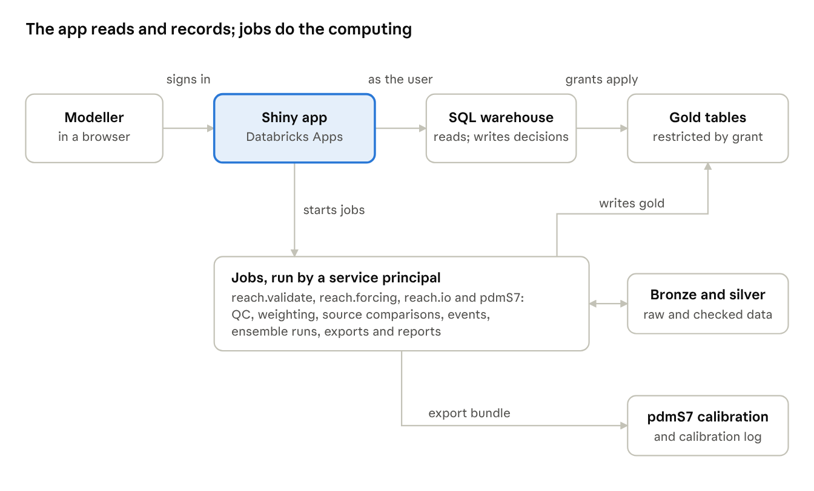

# Explorer specification

The brief for building the catchment explorer as a Shiny app in Databricks: what each screen shows, which tables it reads and what a user can do there. The look follows the mock-up: [Catchment explorer](https://claude.ai/artifact/PxBiJNjZLpa8PLLPv7VDT4).

## Principles

The app displays and records; the jobs compute. That one rule keeps it fast, keeps the numbers identical to the national product, and frees the app from the analysis language.

- **Reads only `gold` tables** and the explorer's own precomputed results. It never reads `bronze`, never runs QC, weighting or a model run.
- **Asks jobs for new work.** A request to run challengers or rebuild an export starts a Databricks job; the app shows its status and reads the result when done.
- **Sees what the user may see.** Queries run as the signed-in user, so Unity Catalog's grants decide whether H19, SAAR and MOSES-based panels show.
- **Writes only decisions.** Weighting choices, event exclusions and acceptance decisions go to `gold.explorer_decisions`, with user, time and reason, and feed the calibration log.
- **Says what it shows.** Every panel names its source table, release and rule version; illustrative or stale data is labelled.

## Architecture

The app talks to a SQL warehouse as the signed-in user, so Unity Catalog's grants decide what each person sees; every computation runs as a job under a service principal and writes back to gold.

The app needs no analysis code of its own, which is why the language question below (R Shiny or Shiny for Python) matters less than it seems: the R stays in the jobs.

## Screen 1: Map

The front door: every flow and level station on one map, searchable, with the selected catchment drawn and its card beside it.

| Panel | Shows | Reads | Actions |
| --- | --- | --- | --- |
| Search | Station name, river, station number, NRFA number | `gold.explorer_card` | Type to find; Enter selects and zooms |
| Stations layer | Flow gauges as circles, level-only as squares; colour by status (open flags, events for review) | `gold.explorer_card` | Click selects; hover shows name and status |
| Catchment layer | The selected catchment's boundary, by source (NRFA, terrain model) | `silver.catchments` (published to gold as `gold.catchment_boundaries`) | Toggle between sources |
| Rain gauges layer | Gauges in and near the catchment, with operational weights | `gold.catchment_gauges` | Click opens the gauge on the Rainfall screen |
| Thiessen layer | Operational polygon edges | `gold.catchment_gauges` | Toggle |
| Grid layers | H19 availability, HadUK annual mean, open-flag gauges | `gold.grid_summaries` | Toggle; restricted layers hidden without the grant |
| Legend and zoom | Symbols; zoom buttons | none | Zoom, reset |

The basemap needs an approved tile source (to confirm, below). Station symbols load once for the whole country; boundaries and gauges load only for the selected station.

## Screen 2: Overview

What the catchment is and what is wrong with its data, on one panel, before anyone opens a time series.

| Panel | Shows | Reads | Actions |
| --- | --- | --- | --- |
| Header | Name, river, station and NRFA numbers; chips for rated or level-only, operational weighting, PACK | `gold.explorer_card` | Copy station link |
| Boundary | Area by source, the area operations use, the difference; amber beyond 5 % | `gold.catchment_boundaries`, `bronze.operational_config` via gold | Open a boundary review |
| Catchment card | Area, SAAR, recent HadUK mean, climate factor c, elevation, bedrock, land cover, BFI, observed flow and the model of record's flow | `gold.explorer_card`, `gold.catchment_checks` | Hover a value for its source and release |
| Checks | The worst open items, red then amber then green: events for review, water balance, open gauge flags, boundary | `gold.catchment_checks`, `silver.events` via gold | Click opens the screen that explains it |
| Actions | Open rainfall inputs; export forcing | none | Navigate; start an export job |

Red means an item blocks calibration (an impossible event, a boundary beyond tolerance); amber means it needs a decision; green means checked and clear.

## Screen 3: Rainfall

The catchment's inputs before calibration: its gauges and their checks, the operational weighting beside the challengers, how the sources compare, and how uncertain each event is.

| Panel | Shows | Reads | Actions |
| --- | --- | --- | --- |
| Map, zoomed | Gauges with weights, Thiessen edges, the flow gauge | `gold.catchment_gauges` | Click a gauge to highlight its row |
| Weighting | Operational baseline (the calibration of record) and the challengers, each labelled as fitting today's system or needing a change | `gold.weighting_schemes` | Pick a scheme to view; request a challenger run (job) |
| Gauges | Weight under the chosen scheme, completeness, open flags, bias index b, gauge ÷ H19, cold-weather share | `gold.catchment_gauges`, `gold.catchment_checks` | Open a gauge's series and flags; raise a flag for review |
| Gauge detail (drawer) | The 15-minute or hourly series with flags marked, double mass against neighbours, monthly ratio to HadUK and H19 | `gold.gauge_series_view`, `gold.catchment_checks` | Zoom in time; confirm or contest a flag (writes a decision) |
| Annual rain by source | Operational, H19, HadUK and SAAR moved to the period, with observed flow | `gold.catchment_checks` | Hover for the years behind each value |
| Temperature bands | Gauge ÷ H19 by temperature band, with the current switch marked | `gold.catchment_checks` | Switch between catchment and individual gauges |
| Event uncertainty | Every event: operational rain, source spread, ensemble rain range, runoff ratio with its range, season and wetness, timing, calibration use | `gold.events` | Exclude, reweight or send to review, with a reason (writes a decision) |

The event table's decisions are what process 4 records: exclusions and weights travel with the export into the calibration.

## Screen 4: Flow and rating

How far the flow record can be trusted, above all for the floods, since the rain is judged against it.

| Panel | Shows | Reads | Actions |
| --- | --- | --- | --- |
| Record | Period, completeness by year, quality codes, gaps | `gold.flow_summary` | Open the series |
| Ratings | Each rating's validity period and limits, as a timeline | `gold.ratings_view` | Pick a rating to plot |
| Gaugings against rating | Every gauging over the rating curve, coloured by year; the highest gauging marked | `gold.ratings_view`, `gold.gaugings_view` | Hover a gauging for date and quality |
| Extrapolation | Share of time and of volume above the highest gauging; the floods that rely on it | `gold.flow_summary`, `gold.events` | Flag events resting on extrapolation |
| Flow series | 15-minute flow, log or linear, with events and rating changes marked | `gold.flow_series_view` | Zoom; jump to an event |
| Level-only stations | Level with its datum, and any threshold levels, in place of flow | `gold.level_series_view` | Shown instead of the panels above |

For level-only stations the explorer offers the catchment, rainfall and checks, but no runoff ratios or model attribution, since there is no flow volume.

## Screen 5: Uncertainty

Shown only where a calibrated model exists: which misses the rain explains and which it cannot, from ensemble runs made in batch, and the decision that follows.

| Panel | Shows | Reads | Actions |
| --- | --- | --- | --- |
| Where the misses come from | Scored events split into rain explains it and the model; excluded events counted and linked to Rainfall | `gold.attribution_summary` | Click a class to filter the event list |
| Events | Each scored event with its class | `gold.attribution_events` | Select an event |
| Hydrograph | Observed flow, the model on best-estimate rain, the 5 to 95 % ensemble band, the threshold | `gold.ensemble_event_series` | Toggle thresholds; switch linear or log |
| Event figures | Observed and model peaks, ensemble range, share of members over the threshold, a one-line reading | `gold.attribution_events` | none |
| Thresholds | Observed crossings, model hits, hits within the ensemble | `gold.threshold_scores` | none |
| Rain error model | Cross-validation error by intensity, season and gauge density | `gold.error_model_summary` | none |
| Decision | Accept, rework inputs or rework the model, with a reason | `gold.explorer_decisions` | Record decision (writes, cites model version and input release) |

Without a calibrated model the screen says so and links to the Rainfall screen's event uncertainty.

## Screen 6: Export

One bundle takes a prepared catchment into pdmS7 with everything the calibration log needs to cite it.

| Item | Contents | Built by |
| --- | --- | --- |
| Forcing | Time, rain (chosen scheme), PET, temperature, flow, at 15 minutes, in the layout `read_hydro_series()` and `register_data()` accept | Export job from `gold.catchment_rain` and the flow tables |
| Events file | Every event with its calibration use: full weight, a weight, or excluded with the reason | Export job from `gold.events` and `gold.explorer_decisions` |
| Provenance | Input release, rule book version, Delta versions of the source tables, weighting scheme, area used, licence of every column | Export job |
| Inputs report | The Overview and Rainfall screens as a static report, for the calibration log | Report job (R Markdown) |

- **Operational baseline by default.** A challenger scheme can be exported only for a challenger calibration, and the bundle says so.
- **Licences enforced.** A bundle containing restricted data is marked restricted and is saved only to a restricted location; the app refuses to offer it for download to users without the grant.
- **Reproducible.** Re-running an export with the same release and versions gives a byte-identical bundle.

## Cross-cutting rules

The same rules hold on every screen, so a link, a permission or a slow query behaves the same wherever it happens.

**State and links**

- The address holds the state: station, screen, scheme, event and gauge (for example `?station=<id>&screen=rainfall&scheme=operational&event=82`). A copied link reopens the same view for anyone allowed to see it.
- Back and forward move between screens and selections.

**Permissions and licences**

- The app queries as the signed-in user; the app's own service principal only starts jobs.
- A panel whose data the user may not see is replaced by a short note naming the licence, not hidden silently.
- Every decision written by the app carries the user, time, reason, input release and model version.

**Performance budgets** (to confirm on the pilot)

| Action | Budget | How |
| --- | --- | --- |
| Open the map, all stations | 2 s | One small summary table, cached per release |
| Select a station | 3 s | Per-station rows in `gold.explorer_card`, clustered by station |
| Open a gauge's series | 2 s | Clustered by gauge and time; hourly unless zoomed in |
| Event hydrograph with ensemble | 2 s | Bands precomputed in batch, never members at view time |

**Accessibility**

- Every control reachable by keyboard; status never shown by colour alone (a word or symbol beside it); text contrast at least 4.5 to 1 in both light and dark themes.

**Empty and partial data**

- A missing table, release or model gives a plain message and the next step, never a blank panel or a stack trace.

## Releases and acceptance

Four releases, each usable on its own and each tied to the data build stage that feeds it.

| Release | Screens | Needs from the data build | Accepted when |
| --- | --- | --- | --- |
| 1 | Map, Overview, Rainfall (gauges, weights, gauge detail) | Stages 1 to 4 and 5.1 to 5.4 for the pilot | Modellers open each pilot catchment, see its gauges, weights and flags, and the operational weights match 1.6 |
| 2 | Rainfall complete (sources, temperature bands, event uncertainty and decisions); Flow and rating | 5.5 to 5.9 | Event decisions export into a pdmS7 calibration that runs |
| 3 | Export and the inputs report | All of Stage 5 | A calibration of record built only from an export reproduces from its provenance |
| 4 | Uncertainty | The error model and ensembles (phase 2) | The attribution for each pilot catchment is reviewed and a decision recorded |

**Open questions**

- [ ] Whether Databricks Apps here run R Shiny, or only Shiny for Python. The analysis stays in R jobs either way; only the app layer changes.
- [ ] The basemap: which tile source is approved and reachable from Databricks (OS Maps API under licence, or an open source).
- [ ] How many flow and level stations the map carries nationally.
- [ ] Whether the app may query as the signed-in user, so Unity Catalog grants apply.
- [ ] Who may record acceptance decisions: the Steward only, or modellers too.
